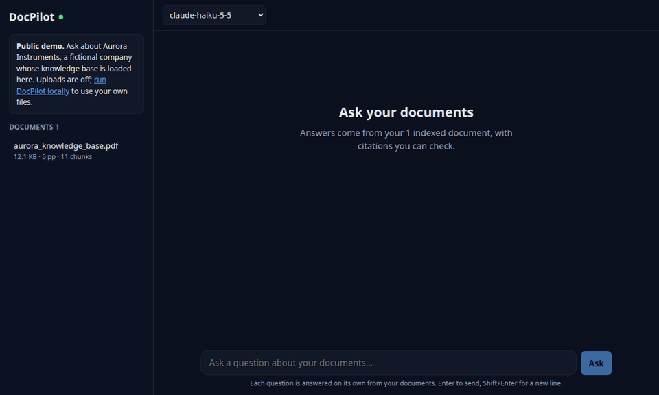
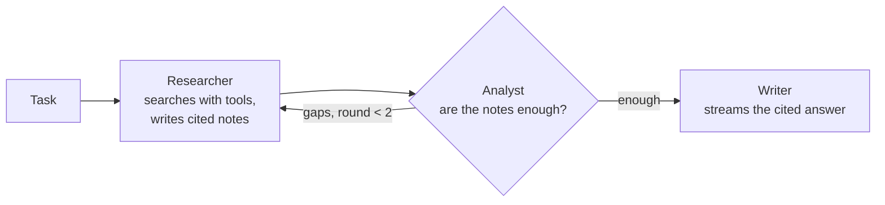
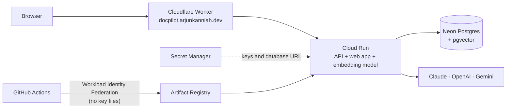

# DocPilot

[](https://github.com/arjun-kanniah/docpilot/actions/workflows/ci.yml)

**Ask questions about your documents and get answers with citations.** Upload PDFs and
Markdown, and DocPilot retrieves the relevant passages and answers with sources you can check.
The LLM provider is switchable per request.

**[Try the live demo](https://docpilot.arjunkanniah.dev)**: ask about a fictional
company's five-document library (read-only, cheap models, rate-limited). See [Deploying](#deploying)
for how it runs.



<sub>Recorded on the live demo with Claude Haiku: a question and a follow-up in Ask mode, then a
task in [Research mode](#agent-mode) in a new chat, across the five-document library, ending
on how the answer was researched. Waits for the model are shortened.</sub>

## Stack

| Layer | Choice |
|---|---|
| API | Python 3.12, FastAPI, managed with [uv](https://docs.astral.sh/uv/) |
| Web | React 19 + TypeScript, Vite |
| Search | PostgreSQL + [pgvector](https://github.com/pgvector/pgvector) |
| LLMs | Claude, OpenAI and Gemini behind one provider interface; [LangGraph](https://langchain-ai.github.io/langgraph/) for agent mode |
| Tooling | [mise](https://mise.jdx.dev) (toolchain), [just](https://just.systems) (tasks), dev container, GitHub Actions |
| Cloud | Google Cloud Run, Neon serverless Postgres, Cloudflare (DNS + Worker), Terraform, deploys from GitHub Actions |

## Quick start

**Option A: dev container (nothing to install but Docker + VS Code).** Open the folder in
VS Code and choose *Reopen in Container*. The first build installs the tools and dependencies
(a few minutes). Then, in VS Code's terminal, which runs inside the container:

```bash
cp .env.example .env  # optional: add API keys
just migrate          # start Postgres + pgvector and create the schema
just dev-api          # terminal 1: API
just dev-web          # terminal 2: web app, open http://localhost:5173
```

VS Code forwards the ports to your browser. Postgres runs in Docker beside the container, not
inside it, so its data survives a rebuild; the container reaches it through
`host.docker.internal`, which overrides the database URL in `.env`.

**Option B: local.**

```bash
mise install          # node, uv, just at pinned versions
cp .env.example .env  # add API keys when needed
just setup            # install backend + frontend dependencies
just migrate          # start Postgres + pgvector in Docker and create the schema
just dev-api          # terminal 1: API on http://localhost:8000
just dev-web          # terminal 2: web app on http://localhost:5173
```

Run `just` to see every task, and `just check` to run what CI runs.

To try it without your own files, upload the [demo library](demo/): five documents about a
fictional company, in which newer documents supersede some of the knowledge base's figures.
Then ask the questions in [`demo/sample_questions.md`](demo/sample_questions.md).

## How ingestion works

1. **Upload** a PDF, Markdown or text file (up to 20 MB). Re-uploading identical bytes is detected
   by SHA-256 and skipped.
2. **Extract** text per page (PDFs keep page numbers for citations).
3. **Chunk** into ~1,000-character passages on paragraph and sentence boundaries, with a
   150-character overlap so a sentence cut at a boundary is still findable.
4. **Embed** each chunk locally with `BAAI/bge-small-en-v1.5` (384 dimensions, CPU, no API cost).
5. **Store** in Postgres with an HNSW index for fast cosine-similarity search.

| Endpoint | Purpose |
|---|---|
| `POST /api/documents` | Upload and index a file |
| `GET /api/documents` | List documents with page and chunk counts |
| `DELETE /api/documents/{id}` | Remove a document and its chunks |
| `POST /api/search` | Top-k passages for a query, with similarity scores |
| `GET /api/models` | Configured LLM providers, their allowed models, and the default |
| `POST /api/ask` | Stream an answer with citations (Server-Sent Events); optional `history` and `document_ids` |
| `POST /api/agent` | Run a research task through the agent, streaming its trace and answer; same options |

## How answering works

1. **Understand follow-ups.** A request can carry the chat's earlier turns. A follow-up such as
   "And the Max?" is first rewritten to stand alone ("How much does the SkyNode Max cost?"),
   because that is what retrieval can search for; the web app shows the rewrite. A question
   that already stands alone costs no extra call.
2. **Retrieve** the passages closest to the question (6 by default), from the whole library or
   only the documents the chat is limited to (`document_ids`).
3. **Prompt** the chosen model with the passages numbered as sources, and the earlier turns as
   context for what the user means. It must cite each claim as `[n]`, prefer the newest source
   when documents disagree, say so when the sources don't hold the answer, and ignore any
   instructions found inside documents.
4. **Stream** the answer back as Server-Sent Events: `rewrite` for a follow-up, `sources` (so
   the UI can show them right away), then `delta` text chunks, then `done` with the model and
   token usage, or `error`.

Validation and retrieval happen before the stream opens, so a bad request gets a normal 4xx.

**Chats** are kept in the browser, newest first, so the public demo needs no accounts. Each chat
remembers its turns and which documents it searches: untick documents in the sidebar to limit
it. On the demo, try the same pricing question in a chat limited to the 2026 knowledge base and
in one using the whole library: $299 against $319.

The web app renders answers as Markdown (including tables) with citations as links to their
sources. Because answers are shaped by uploaded documents, raw HTML is dropped and images are
never loaded, so a malicious document can't inject script or leak data through an image URL.

### Choosing a model

Providers are enabled by their API keys in `.env` (`ANTHROPIC_API_KEY`, `OPENAI_API_KEY`,
`GEMINI_API_KEY`).
The default is `DOCPILOT_LLM_PROVIDER` / `DOCPILOT_LLM_MODEL`, and a request (or the picker
in the UI) can choose any allowlisted model:

| Provider | Models (first is the default) |
|---|---|
| Claude | `claude-opus-5-5`, `claude-sonnet-5-5`, `claude-haiku-5-5` |
| OpenAI | `gpt-6.1-sol`, `gpt-6-luna`, `gpt-6-astra` |
| Gemini | `gemini-3.8-flash`, `gemini-3.5-flash-lite` |

The allowlist lives in [`backend/src/docpilot/llm/providers.py`](backend/src/docpilot/llm/providers.py).
Each provider wraps its official SDK behind one small streaming interface
([`llm/base.py`](backend/src/docpilot/llm/base.py)), so adding one is a single file.

Interactive API docs are at http://localhost:8000/docs while `just dev-api` is running.

## Agent mode

**Research** mode (the toggle above the chat) takes a task rather than a single question, for
example *"Which model and cloud plan suit a vineyard with no Wi-Fi, and what would the first
year cost?"*. Three roles work through it in a [LangGraph](https://langchain-ai.github.io/langgraph/)
graph ([`agent/graph.py`](backend/src/docpilot/agent/graph.py)):



- **The researcher** calls tools: `list_documents` and `search_library`, up to 6 calls a
  round, with short single-topic queries (long keyword lists retrieve general passages and miss
  specific ones). Every passage it sees gets one number for the whole run, so the writer's `[n]`
  citations link to the same sources panel as in Ask mode.
- **The analyst** checks the notes against the sources and returns a structured verdict:
  `corrections` (claims the sources don't support, wrong units, arithmetic slips), `gaps`
  (things a new search could find) and a `summary`. Gaps send the researcher back, at most
  twice, and research also stops when a round finds no new passages. A claim that the library
  doesn't cover something counts only after a focused search for it.
- **The writer** answers only from the notes and sources, under the same citation and
  injection rules as Ask mode.
- **The run is visible.** `POST /api/agent` streams each step, tool call (with a summary such as
  "5 passages (pages 2, 3, 5)"), the notes and the analyst's verdict before the answer, and the
  web app shows them as a trace that folds away once the answer arrives.

The same graph runs on Claude, OpenAI or Gemini through LangChain's chat models, chosen per
request from the same allowlist. LangGraph loads on the first agent run, so it doesn't slow
cold starts. On the public demo a run counts as 5 questions against the hourly limit, since it
makes several model calls (on Claude Haiku the evaluation tasks averaged 1.4 rounds, 4.6 tool
calls and about 21K input tokens).

## Evaluation

[`demo/`](demo/) holds a fictional company's knowledge base and 21 questions with reference
answers, including two the document can't answer. `just eval` runs them through the same
prompt and streaming path as the app, and `claude-opus-5-5` grades each answer against its
reference with a structured verdict. Retrieval and citations are scored in code.

| Answering model | Correct | Declined when it should | Cites the right page | Cost per question |
|---|---|---|---|---|
| Claude Opus 5.5 | 19/19 | 2/2 | 100% | ~$0.013 |
| Claude Haiku 5.5 | 19/19 | 2/2 | 100% | ~$0.0003 |
| GPT-6.1 Sol | 19/19 | 2/2 | 100% | ~$0.003 |
| GPT-6 Luna | 19/19 | 2/2 | 100% | ~$0.0002 |
| Gemini 3.5 Flash-Lite | 19/19 | 2/2 | 100% | free tier |

Retrieval finds the right page for every question (mean reciprocal rank 1.00), and CI fails if
that drops below 90%. The grader is checked first: it passes the reference answers and fails
"I don't know". This small set is a regression check rather than a benchmark. See
[the results and their caveats](demo/eval-results/).

**Research mode** has its own set: 8 tasks that combine facts from several pages with a
condition or arithmetic, plus 2 the document can't answer. `just eval-agent` runs them through
the agent graph, grades the answers the same way, and checks in code that each run found and
cited every page the answer needs and states the key figures.

| Model (every agent step) | Correct | Declined when it should | Found every evidence page | Rounds / tool calls per task | Cost per task |
|---|---|---|---|---|---|
| Claude Haiku 5.5 | 6/6 | 2/2 | 100% | 1.4 / 4.6 | ~$0.004 |
| GPT-6 Luna | 6/6 | 2/2 | 100% | 1.2 / 4.6 | ~$0.002 |
| Gemini 3.5 Flash-Lite | 5/6 | 2/2 | 100% | 1.0 / 2.6 | free tier |

Flash-Lite's miss is a real one: it priced a per-account plan per station.

A second set runs over the whole five-document [demo library](demo/), where newer documents
supersede the knowledge base's prices and rules. Two runs per model:

| Model | Correct (run 1 / run 2) | Declined when it should | Found every piece of evidence |
|---|---|---|---|
| Claude Haiku 5.5 | 8/8, 8/8 | 2/2, 2/2 | 100% |
| GPT-6 Luna | 6/8, 8/8 | 2/2, 2/2 | 100% |
| Gemini 3.5 Flash-Lite | 8/8, 8/8 | 2/2, 2/2 | 100% |

Conflicting versions were the main failure: one prompt rule for documents that disagree took
the set from 56 to 58 of 60. These tasks also drove the agent's design; see
[what the sets found](demo/eval-results/agent/).

## Deploying

The public demo runs on Google Cloud Run with a [Neon](https://neon.tech) Postgres database,
behind a Cloudflare Worker that serves the custom domain. All three have free tiers and the
first two scale to zero, so an idle demo costs nothing.



- **One container** serves the API and the built web app, with the embedding model baked in so
  cold starts never download it ([`Dockerfile`](Dockerfile)).
- **Every push to `main`** that passes CI builds the image, runs a migration job (which also
  loads the demo PDF), deploys a new revision and smoke-tests it, using the blueprint's
  reusable deploy workflow.
- **[`infra/`](infra/)** (Terraform) builds on
  [cloudrun-blueprint](https://github.com/arjun-kanniah/cloudrun-blueprint), my reusable
  modules for Cloud Run: the service, the migration job, least-privilege service accounts,
  GitHub's deploy access (limited to this repo's `main` branch), a budget alert and the Worker.
  DocPilot adds its own settings and the rest of the Cloudflare side: redirects and email. Provider keys, the database URL and the
  Cloudflare token are stored with `just secret`, so they never reach code or Terraform state.
- **Why a Worker for the domain:** Cloud Run's built-in domain mapping isn't offered in
  us-east5, a Google load balancer costs about USD 18 a month, and Firebase Hosting buffers
  responses, which would break streamed answers. The Worker streams them through
  ([`proxy.js`](https://github.com/arjun-kanniah/cloudrun-blueprint/blob/v0.1.0/modules/cloudflare-domain/worker/proxy.js)) and passes on the visitor's IP for the rate
  limit, with a shared secret so direct callers can't forge it.

**Demo mode** (`DOCPILOT_DEMO_MODE=true`) guards the public URL: the document library is
read-only, only cheap models are offered, each visitor gets 20 questions an hour, and
instances are capped at two. The demo's API keys also have spend limits set at each provider.

One-time setup, using a dedicated gcloud profile named `docpilot`:

```bash
just infra-bootstrap                 # APIs, Terraform state bucket, terraform init
just secret database-url             # Neon connection string; likewise anthropic-api-key,
                                     # openai-api-key, gemini-api-key, cloudflare-api-token
cp infra/terraform.tfvars.example infra/terraform.tfvars   # then fill it in
just infra apply                     # everything else (the domains must already be
                                     # active zones in Cloudflare)
```

Then set the repository variables `GCP_PROJECT_ID`, `GCP_REGION`, `GCP_WIF_PROVIDER` and
`GCP_DEPLOY_SA` from `just infra output`, and the next push to `main` deploys.

## Project layout

```
backend/        FastAPI service (src/docpilot), Alembic migrations, tests
frontend/       React + TypeScript web app
demo/           fictional document library, evaluation sets and results
infra/          Terraform for Google Cloud and Cloudflare (uses cloudrun-blueprint)
Dockerfile      production image (API + web app + embedding model)
.devcontainer/  reproducible dev environment
justfile        task runner: setup, dev, lint, test, eval, infra
mise.toml       pinned toolchain
```

## Roadmap

- [x] Skeleton: API + web app, dev container, CI
- [x] Ingestion: upload PDF/Markdown/text → chunk → embed locally → store in pgvector
- [x] Semantic search over chunks, with page references
- [x] Q&A: retrieve passages, stream answers with citations
- [x] Provider switch: Claude, OpenAI and Gemini behind one interface, per request
- [x] Evaluation: a question set with graded answers; retrieval checked in CI
- [x] Deploy: Cloud Run + Neon via Terraform, deployed from CI, with spend guardrails
- [x] Custom domain through a Cloudflare Worker, keeping answers streamed
- [x] Agent mode: a LangGraph researcher, analyst and writer, with a visible trace
- [x] Evaluation for Research mode: multi-step tasks, evidence and key-figure checks
- [x] A harder corpus: five documents in three formats, near-duplicate passages, conflicting
  versions, with its own Research mode evaluation
- [x] Chats: saved in the browser, follow-up questions rewritten to stand alone, and each chat
  limited to the documents it chooses
- [ ] Research mode evaluation in CI on a schedule, with a pass threshold

## License

[MIT](LICENSE)
